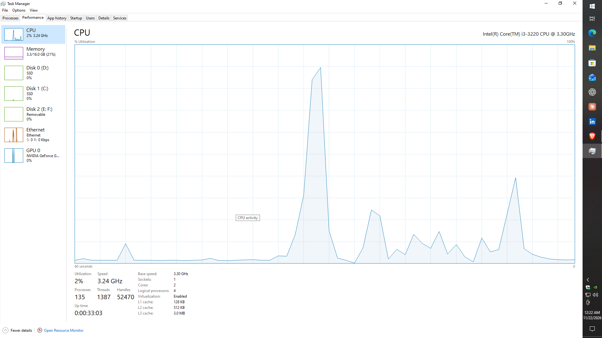
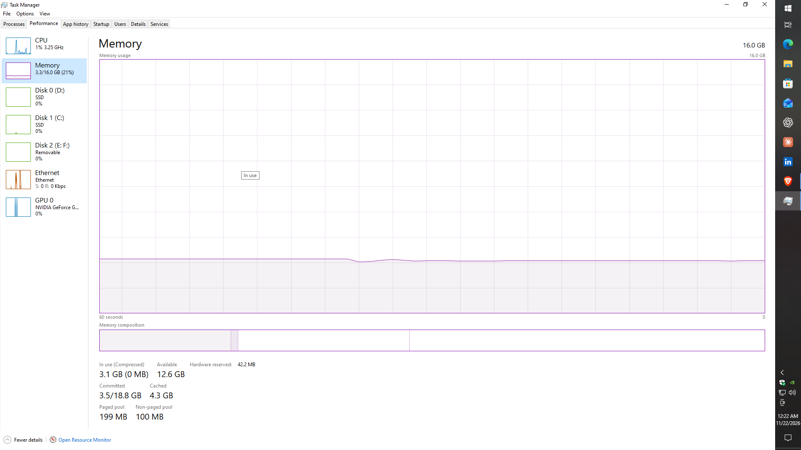
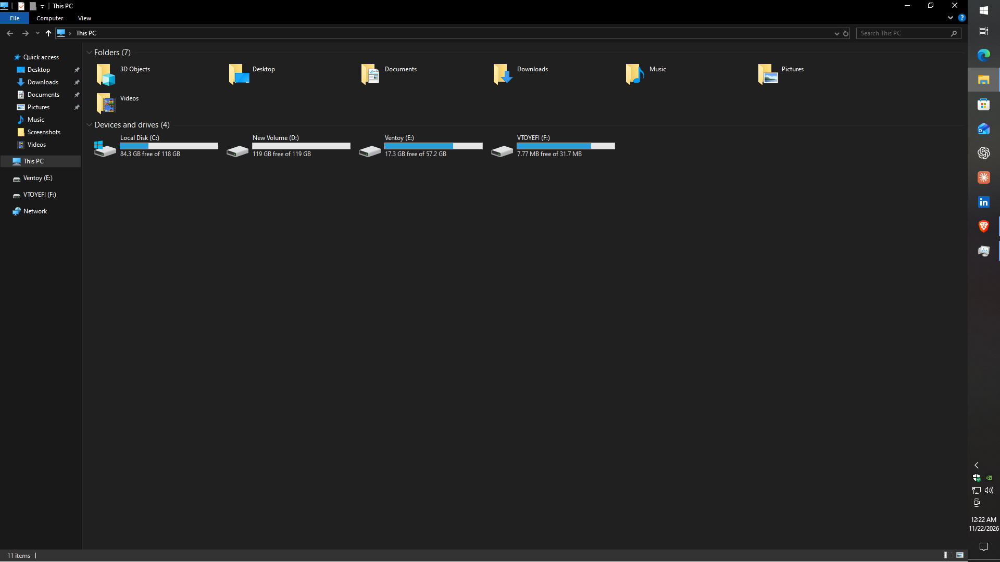
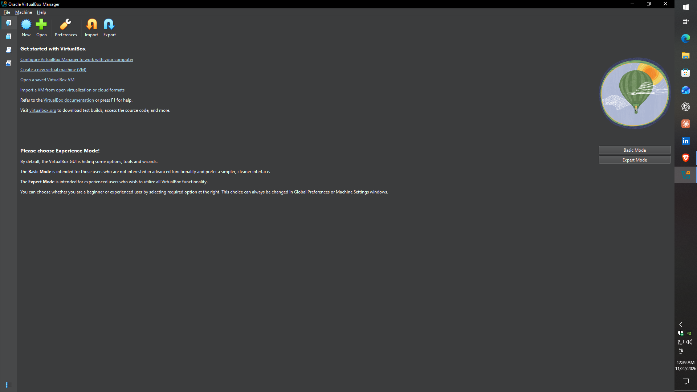
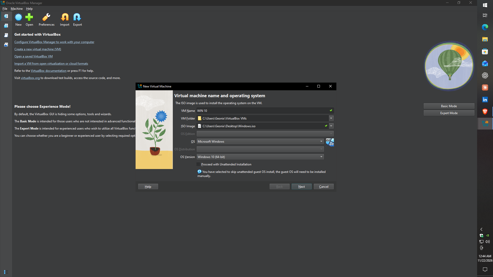
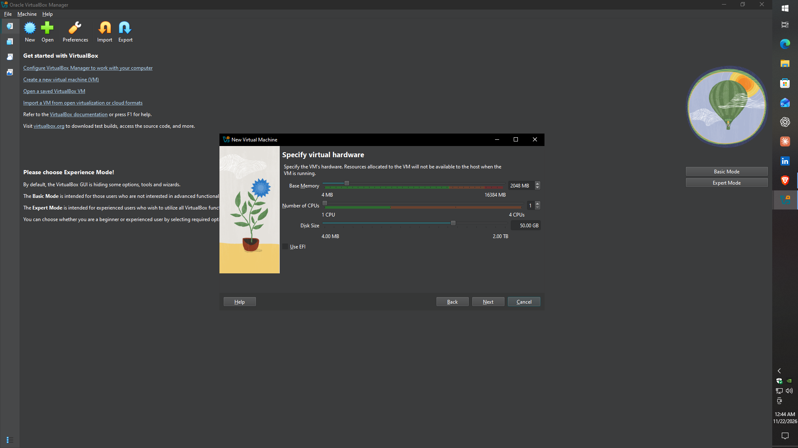
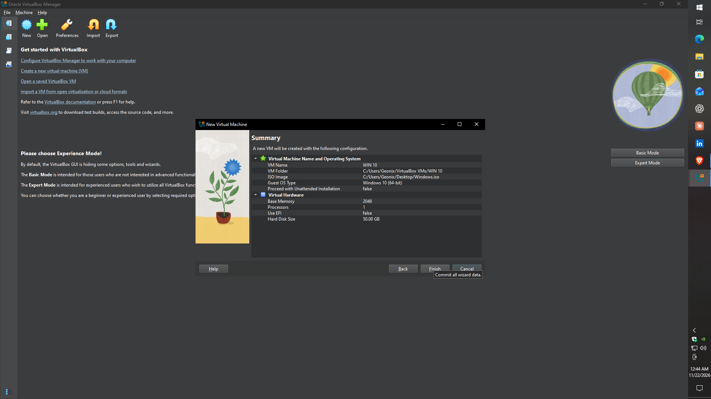
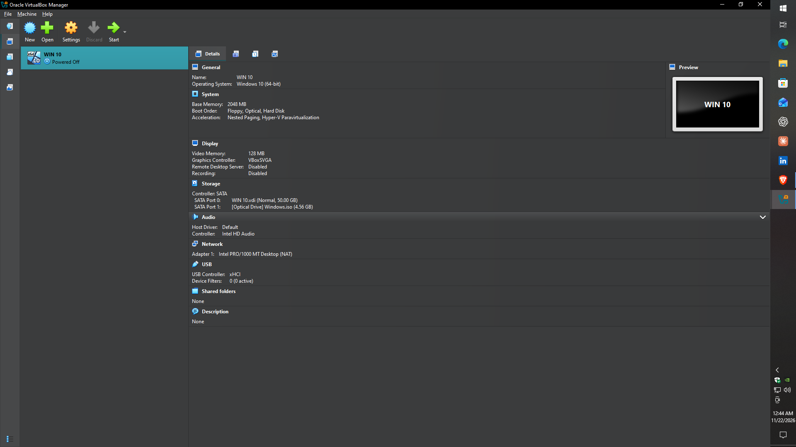
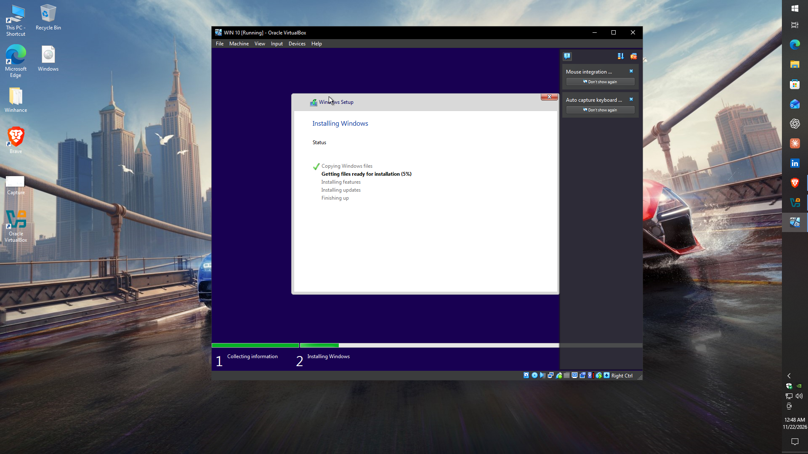
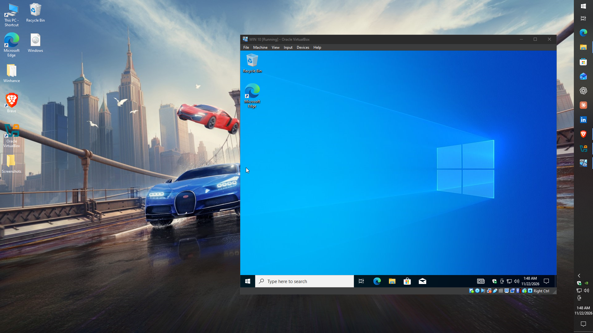

# Windows 10 Installation on VirtualBox

## Step 1: Check system information

I checked that virtualization is enabled on my PC.

## Step 2: Check RAM

I checked how much RAM I can give to the VM.

## Step 3: Check storage

I checked that there is enough free disk space.

## Step 4: Open VirtualBox

## Step 5: Create the VM

## Step 6: Hardware configuration

## Step 7: Review VM details

## Step 8: Windows 10 setup

## Step 9: Installation

## Step 10: Finished, VM home screen

